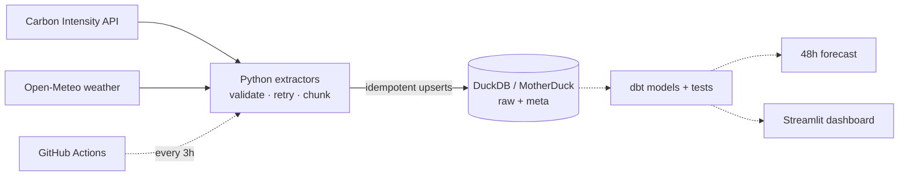

# GB Grid Carbon Tracker


> **When is the cleanest time to use electricity in Great Britain, what drives it, and can we
> predict it?**

An automated data pipeline for half-hourly GB grid carbon intensity, generation mix and weather.
**Working today:** validated extraction from two public APIs, idempotent loading into DuckDB, and
a full backfill since 2017 (~2.3M rows). **In progress:** dbt models, a scheduled pipeline, a 48h
forecast benchmarked against the official one, and a live dashboard (see [Status](#status)).
Everything runs on free tiers.


<sub>Solid lines are built; dotted lines are planned.</sub>

## Highlights so far

Found by running against the real APIs, not by unit tests (full write-up in
[`docs/dev_log.md`](docs/dev_log.md)):

- **Silent data loss found by a data-quality check.** After the backfill, a gap query against a
  complete half-hour time spine showed 10.4% of generation-mix periods missing, including *every*
  January 2021–2024. The API returns HTTP 200 but silently drops everything after 31 December when
  a request spans New Year. Splitting requests at 1 January cut missing data to **0.29%**.
- **An off-by-30-minutes API limit.** "Max 31 days per request" also rejects *exactly* 31 days,
  because the API adds the half-hour ending at the start time. Fixed with whole-day windows under
  the limit, plus a regression test that keeps every request inside it.
- **Rate limiting handled by design.** Open-Meteo's per-minute quota stopped the weather
  backfill. The retry backoff was lengthened, and the backfill resumed from the failed window
  because every loaded window is logged.

## Status

| Phase | Scope | Status |
|---|---|---|
| 1 | Scaffold, tooling, CI | ✅ Done |
| 2 | Live API exploration → `docs/data_dictionary.md` | ✅ Done |
| 3 | Extraction + idempotent loading + backfill (48 offline tests; ~2.3M rows since 2017) | ✅ Done |
| 4 | MotherDuck cloud warehouse (same code, `DB_TARGET=motherduck`) | ✅ Done |
| 5 | dbt models + data tests + docs site | ⏳ |
| 6 | Scheduled GitHub Actions pipeline | ⏳ |
| 7 | Analysis & findings | ⏳ |
| 8 | 48h forecast vs NESO benchmark | ⏳ |
| 9 | Live Streamlit dashboard | ⏳ |

Full plan: [`docs/project_plan.md`](docs/project_plan.md). Decisions and surprises:
[`docs/dev_log.md`](docs/dev_log.md).

## Quickstart

Requires Python 3.11+.

**Windows (PowerShell)**
```powershell
py -3.13 -m venv .venv
.\.venv\Scripts\python.exe -m pip install -e ".[dev]"
.\.venv\Scripts\gridcarbon.exe init-db
.\.venv\Scripts\gridcarbon.exe incremental      # last few days of every dataset
.\.venv\Scripts\gridcarbon.exe backfill         # full history (resumable, ~10-20 min)
.\.venv\Scripts\gridcarbon.exe status
.\.venv\Scripts\python.exe -m pytest            # offline tests
```

**Linux / macOS / CI**
```bash
python -m venv .venv && source .venv/bin/activate
make setup && make init-db && make incremental && make status && make check
```

Configuration is via environment variables or a `.env` file (copy `.env.example`).
To use the cloud warehouse instead of the local file, put a [MotherDuck](https://motherduck.com)
token in `.env` and run any command with `DB_TARGET=motherduck` (PowerShell:
`$env:DB_TARGET="motherduck"`). The database is created on first connect.

## Commands

| Command | What it does |
|---|---|
| `gridcarbon init-db` | Create `raw` / `meta` schemas and tables (idempotent) |
| `gridcarbon backfill [-d DATASET]... [--start] [--end]` | Load history window by window; re-run resumes where it stopped |
| `gridcarbon incremental` | Re-fetch from (latest row − 3 days) to now for every dataset, and snapshot the live forecasts |
| `gridcarbon status` | Row counts, time coverage and the latest runs |

Datasets: `intensity`, `generation`, `regional` (opt-in for backfill: ~800 MB of JSON),
`weather_observed`, `weather_historical_forecast`.

## Engineering notes

- **Idempotent by design:** loads upsert on natural keys inside a transaction; an empty or partial
  API response can never delete history. Running any command twice changes nothing.
- **Late-arriving data:** `actual` intensity is published after the fact, so every incremental run
  re-fetches the last 3 days. The window anchors on the latest loaded row, so the pipeline catches
  up on its own after an outage.
- **Fail loudly:** every API response is validated with pydantic (30-minute periods, valid index
  values, 0–100 % fuel shares, UTC-only weather). Invalid data stops the run; it is never dropped.
- **Transient vs permanent errors:** 429/5xx/timeouts retry with exponential backoff; 4xx fail
  immediately.
- **Observability:** every run is recorded in `meta.pipeline_runs` (status, rows, error) and every
  loaded window in `meta.load_log`.
- **Tests run offline:** recorded real API responses (`tests/fixtures/`, refreshed by
  `scripts/record_fixtures.py`) plus an in-memory DuckDB.

## Data sources & licences

- Carbon Intensity API, National Energy System Operator (NESO): CC BY 4.0.
- Weather data by [Open-Meteo.com](https://open-meteo.com/), CC BY 4.0 (non-commercial use).

See [`docs/data_dictionary.md`](docs/data_dictionary.md) for every field, limit and quirk.
