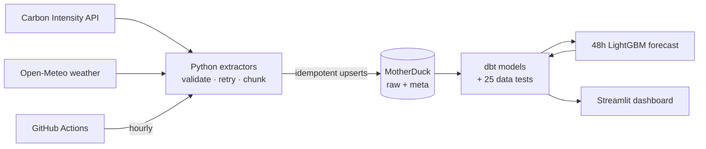
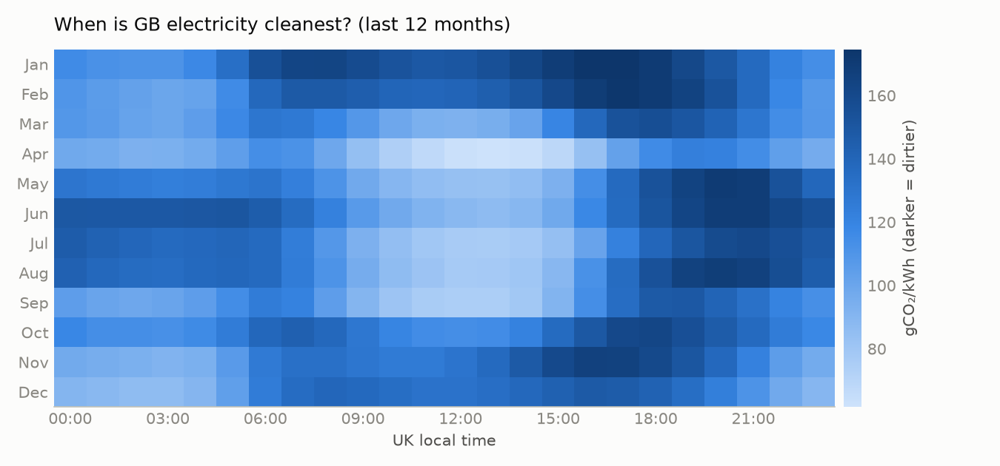

# GB Grid Carbon Tracker


· **[Live dashboard](https://gb-grid-carbon-b8k4zy3yzvfzqzxewxzdsk.streamlit.app/)** · [dbt docs & lineage](https://p3rpetualpanda.github.io/gb-grid-carbon/)

> **When is the cleanest time to use electricity in Great Britain, what drives it, and can we
> predict it?**

An automated pipeline that collects half-hourly GB grid carbon intensity, generation mix and
weather every few hours, models and tests it with dbt, forecasts the next 48 hours with LightGBM,
scores that forecast live against the official one, and serves a Streamlit dashboard. About 2.6M
rows since 2017, all on free tiers.



## Key findings

From [`docs/findings.md`](docs/findings.md) (every number computed by `analysis/findings.py`, with
95% block-bootstrap confidence intervals). For the business version, see the one-page
**[stakeholder brief](docs/brief.md)** (findings → recommendations → limitations).

- **Carbon intensity fell 48%** (95% CI 44–52%), from 248 gCO₂/kWh in 2018 to 129 in 2025. Wind went from 18% to
  32% of generation, gas from 41% to 28%, and coal disappeared.
- **Midday is now the cleanest time of day from spring to autumn** (solar). Evenings are dirtiest
  all year, and electricity at 03:00 is 26% cleaner than at 18:00.
- **Wind is the main driver:** each +10 km/h of wind is associated with 35 gCO₂/kWh lower
  intensity (r = −0.55).
- **A 33× regional gap:** South Scotland averaged 8 gCO₂/kWh over the last year, South Wales 252.
- **Smart EV charging** (cleanest 3 h overnight instead of plugging in at 18:00) cuts emissions by
  29% (95% CI 26–32%), about 113 kg CO₂ per car per year.



## The forecast

A direct multi-horizon LightGBM model predicts all 96 half-hours of the next 48 h. Over a 12-month
rolling-origin backtest (last run <!-- bt:run_date -->2026-10-18<!-- /bt -->) its MAE is **<!-- bt:model_mae -->26.8<!-- /bt --> gCO₂/kWh**,
**<!-- bt:improvement -->39%<!-- /bt --> better** than the best naïve baseline (<!-- bt:best_baseline_mae -->44.3<!-- /bt -->), and it beats "repeat the last
actual" at every lead time. NESO's published forecast scores <!-- bt:neso_mae -->9.9<!-- /bt -->, but the API keeps only NESO's *final*, short-lead forecast, so the fair comparison is the
**live track record**: both forecasts issued in the same pipeline run, scored when actuals arrive
(`marts.fct_model_vs_official`, shown in the dashboard). Leakage rules (publication lag,
forecast-not-observed weather, train-before-test) are enforced by tests. Details:
[`docs/backtest.md`](docs/backtest.md).

## Engineering highlights

Found by running against the real APIs, not by unit tests (full write-up in
[`docs/dev_log.md`](docs/dev_log.md)):

- **Silent data loss found by a data-quality check.** After the backfill, a gap query against a
  complete half-hour time spine showed 10.4% of generation-mix periods missing, including *every*
  January 2021–2024. The API returns HTTP 200 but silently drops everything after 31 December when
  a request spans New Year. Splitting requests at 1 January cut missing data to **0.29%**.
- **An off-by-30-minutes API limit.** "Max 31 days per request" also rejects *exactly* 31 days,
  because the API adds the half-hour ending at the start time. Fixed with whole-day windows under
  the limit, plus a regression test that keeps every request inside it.
- **A dbt test caught impossible upstream forecasts.** A physical-range test (0–1000 gCO₂/kWh)
  flagged 16 half-hours in 2018–19 where NESO's published forecast was up to 13,579, about 50×
  reality, while actuals were normal. Staging nulls and flags them (raw keeps the original), so
  they can't distort forecast-accuracy analysis.
- **Rate limiting handled by design.** Open-Meteo's per-minute quota stopped the weather
  backfill. The retry backoff was lengthened, and the backfill resumed from the failed window
  because every loaded window is logged.
- **A live forecast that looked wrong, investigated properly.** On day one the model forecast
  ~170 for 13:30 when the last actual was 88 (it turned out to be 86). Diagnosis: a train/serve
  skew (training issue times on a fixed 6 h grid; fixed with a 6.5 h grid that cycles through
  every half-hour), plus the model under-weighting the latest actual at very short leads. A
  persistence blend was tuned on half the backtest and checked on the other half: 0–2 h error
  fell from 19.1 to 17.0.

## Status

| Phase | Scope | Status |
|---|---|---|
| 1 | Scaffold, tooling, CI | ✅ Done |
| 2 | Live API exploration → `docs/data_dictionary.md` | ✅ Done |
| 3 | Extraction + idempotent loading + backfill (48 offline tests; ~2.3M rows since 2017) | ✅ Done |
| 4 | MotherDuck cloud warehouse (same code, `DB_TARGET=motherduck`) | ✅ Done |
| 5 | dbt models (staging → marts) + 25 data tests | ✅ Done |
| 6 | Scheduled GitHub Actions pipeline (hourly) + dbt docs site | ✅ Live |
| 7 | Analysis & findings → [`docs/findings.md`](docs/findings.md) | ✅ Done |
| 8 | 48h forecast, backtest, live scoring vs NESO → [`docs/backtest.md`](docs/backtest.md) | ✅ Live |
| 9 | Streamlit dashboard (`app/streamlit_app.py`) → [live](https://gb-grid-carbon-b8k4zy3yzvfzqzxewxzdsk.streamlit.app/) | ✅ Live |

Full plan: [`docs/project_plan.md`](docs/project_plan.md). Decisions and surprises:
[`docs/dev_log.md`](docs/dev_log.md). CV bullets and interview notes:
[`docs/showcase.md`](docs/showcase.md).

## Quickstart

Requires Python 3.11+.

**Windows (PowerShell)**
```powershell
py -3.13 -m venv .venv
.\.venv\Scripts\python.exe -m pip install -e ".[dev]"
.\.venv\Scripts\gridcarbon.exe init-db
.\.venv\Scripts\gridcarbon.exe incremental      # last few days of every dataset
.\.venv\Scripts\gridcarbon.exe backfill         # full history (resumable, ~10-20 min)
.\.venv\Scripts\gridcarbon.exe status
.\.venv\Scripts\python.exe -m pytest            # offline tests
```

**Linux / macOS / CI**
```bash
python -m venv .venv && source .venv/bin/activate
make setup && make init-db && make incremental && make status && make check
```

Configuration is via environment variables or a `.env` file (copy `.env.example`).
To use the cloud warehouse instead of the local file, put a [MotherDuck](https://motherduck.com)
token in `.env` and run any command with `DB_TARGET=motherduck` (PowerShell:
`$env:DB_TARGET="motherduck"`). The database is created on first connect.

## Commands

| Command | What it does |
|---|---|
| `gridcarbon init-db` | Create `raw` / `meta` schemas and tables (idempotent) |
| `gridcarbon backfill [-d DATASET]... [--start] [--end]` | Load history window by window; re-run resumes where it stopped |
| `gridcarbon incremental` | Re-fetch from (latest row − 3 days) to now for every dataset, and snapshot the live forecasts |
| `gridcarbon predict` | Train on all history and write the next 48 h forecast to `ml.model_forecasts` (needs `.[ml]`) |
| `gridcarbon status` | Row counts, time coverage and the latest runs |
| `python analysis/findings.py` | Regenerate `docs/findings.md` + charts from the marts (needs `.[analysis]`) |
| `python analysis/backtest.py` | Re-run the 12-month backtest → `docs/backtest.md` + `docs/backtest_results.json` (~30 s) |
| `python scripts/update_backtest_docs.py` | Copy the latest backtest numbers into this README and `docs/showcase.md` |
| `streamlit run app/streamlit_app.py` | Dashboard; reads MotherDuck if `MOTHERDUCK_TOKEN` is set, else the local file |

dbt (from the `dbt/` folder): `dbt build --profiles-dir .` builds and tests every model against
the local warehouse; set `DBT_TARGET=prod` (plus `MOTHERDUCK_TOKEN`) for MotherDuck.
Main table: `marts.fct_grid_halfhourly`, one row per half-hour on a complete time spine, with
intensity, generation mix, weather and UK local-time calendar.

Datasets: `intensity`, `generation`, `regional` (opt-in for backfill: ~800 MB of JSON),
`weather_observed`, `weather_historical_forecast`.

## Engineering notes

- **Idempotent by design:** loads upsert on natural keys inside a transaction; an empty or partial
  API response can never delete history. Running any command twice changes nothing.
- **Late-arriving data:** `actual` intensity is published after the fact, so every incremental run
  re-fetches the last 3 days. The window anchors on the latest loaded row, so the pipeline catches
  up on its own after an outage.
- **Fail loudly:** every API response is validated with pydantic (30-minute periods, valid index
  values, 0–100 % fuel shares, UTC-only weather). Invalid data stops the run; it is never dropped.
- **Transient vs permanent errors:** 429/5xx/timeouts retry with exponential backoff; 4xx fail
  immediately.
- **Observability:** every run is recorded in `meta.pipeline_runs` (status, rows, error) and every
  loaded window in `meta.load_log`.
- **Tests run offline:** recorded real API responses (`tests/fixtures/`, refreshed by
  `scripts/record_fixtures.py`) plus an in-memory DuckDB.

## Data sources & licences

- Carbon Intensity API, National Energy System Operator (NESO): CC BY 4.0.
- Weather data by [Open-Meteo.com](https://open-meteo.com/), CC BY 4.0 (non-commercial use).

See [`docs/data_dictionary.md`](docs/data_dictionary.md) for every field, limit and quirk.
