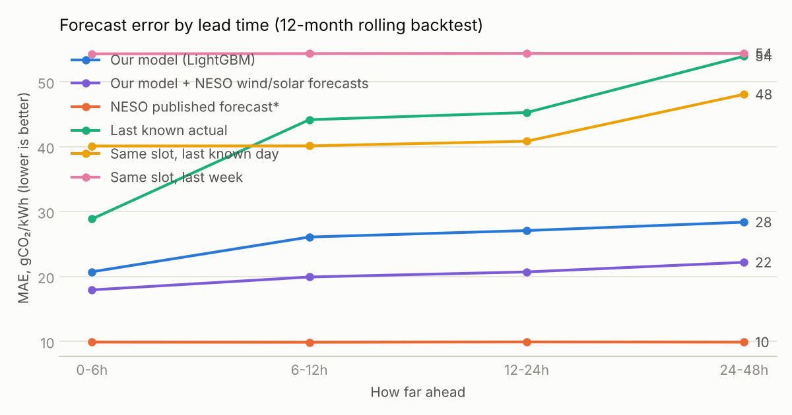

# Forecast backtest

_Generated by `analysis/backtest.py`. 1,348 forecasts issued every 6 h
over the last 12 months, each predicting the next 48 h (96 half-hours): 129,408 predictions._

**Method.** Direct multi-horizon LightGBM: one model, lead time as a feature, pulled towards the
last known actual at short leads (weight exp(-(lead-1)/6), tuned on the first 6 test months only).
Training issues every 6.5 h, so every half-hour of the day is seen as an issue time. Rolling origin: for
each test month the model is retrained only on rows whose *targets* fall before the month starts.
Features use only data available at issue time: actuals end 1 h before issue (publication lag),
"same slot" lags reach back as many whole days as needed to land on known data, and weather is
Open-Meteo's *historical forecast*, never observed weather. These rules are enforced by
`tests/test_forecast.py`.

**Result.** Over all leads the model's MAE is **26.8 gCO₂/kWh**, vs
**44.3** for the best naïve baseline (**39%
better**) and **9.9** for NESO's published forecast. Adding NESO's own
day-ahead wind and embedded wind/solar forecasts as inputs (the vintage issued before each
forecast, never a later one) gives **21.0**; it is a candidate, not yet the
live model.

|  | Our model (LightGBM) | Our model + NESO wind/solar forecasts | NESO published forecast* | Last known actual | Same slot, last known day | Same slot, last week |
| --- | --- | --- | --- | --- | --- | --- |
| 0-6h | 20.7 | 17.9 | 9.9 | 28.9 | 40.1 | 54.3 |
| 6-12h | 26.1 | 19.9 | 9.9 | 44.2 | 40.1 | 54.4 |
| 12-24h | 27.1 | 20.7 | 9.9 | 45.3 | 40.8 | 54.4 |
| 24-48h | 28.4 | 22.2 | 9.9 | 53.9 | 48.1 | 54.4 |
| all | 26.8 | 21 | 9.9 | 47.4 | 44.3 | 54.4 |

\* **Read the NESO column with care.** The API only keeps NESO's *final* published forecast for
each half-hour, not when it was made, so it is likely a short-lead forecast. That makes it a
flattering benchmark at long leads. The fair head-to-head is the live track record
(`marts.fct_model_vs_official`), which compares both forecasts issued in the same pipeline run.

**Caveat.** Open-Meteo's historical forecasts are stitched from the first hours of each model run,
so training weather is closer to a short-range forecast than a true 48 h one. Expect live errors
at long leads to be somewhat higher than this backtest.

**What drives the model** (share of total gain):

|  | gain_share |
| --- | --- |
| wind_speed | 0.36 |
| lag_day | 0.173 |
| last_actual | 0.123 |
| lag_week | 0.076 |
| month | 0.058 |
| halfhour_slot | 0.053 |
| temperature | 0.049 |
| iso_weekday | 0.046 |
| solar_radiation | 0.027 |
| mean_24h | 0.02 |
| lead | 0.01 |
| is_holiday | 0.005 |
