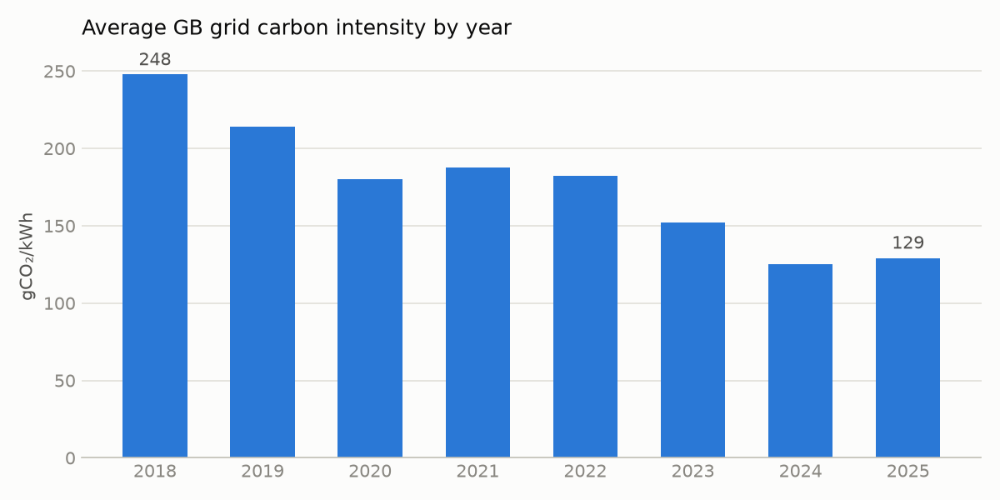
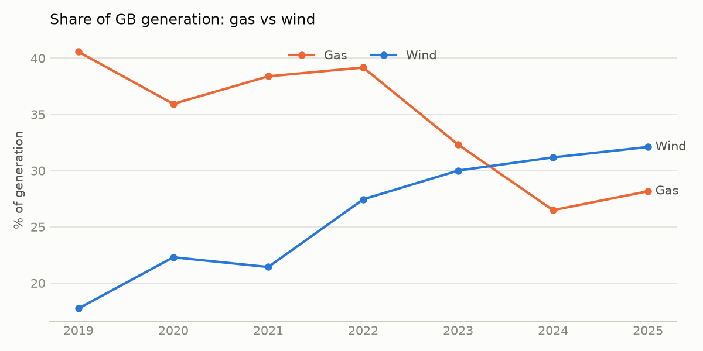
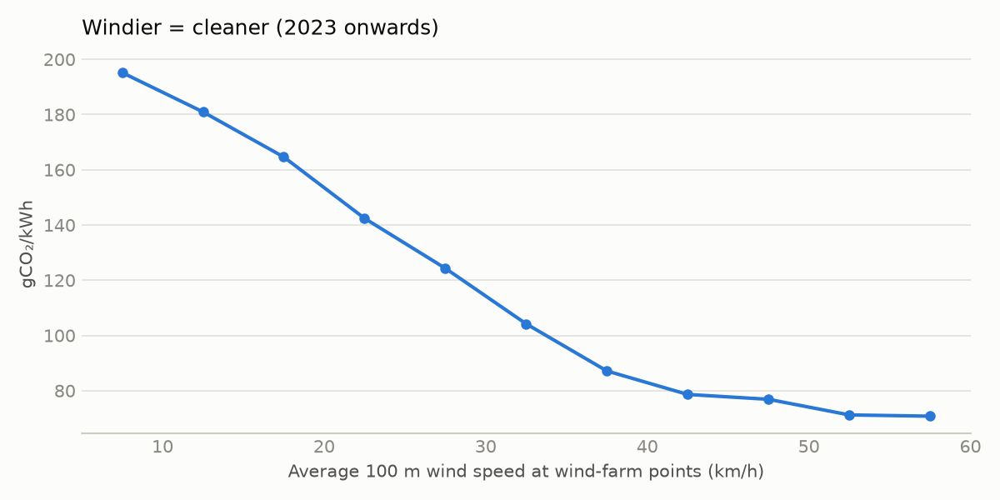
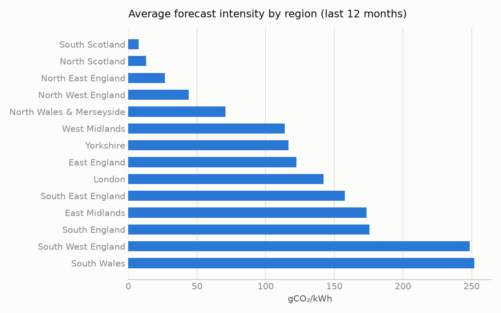

# Findings

_Generated by `analysis/findings.py` from the dbt marts; every number is computed, none typed.
Times are UK local time. "Last 12 months" = the 365 days to the latest loaded half-hour._

**How sure are these numbers?** Each headline effect has a 95% confidence interval from a block
bootstrap: whole weeks are resampled with replacement (1,000 times; 500 for the regression), so
multi-day weather spells stay together and the intervals aren't falsely narrow. An interval that
doesn't include zero means the effect is very unlikely to be chance.

## 1. The grid has decarbonised fast
Average carbon intensity fell **48%** (95% CI 44% to 52%), from **248** gCO₂/kWh in 2018 to **129** in 2025. Wind's share of generation went from 18% (2019) to 32% (2025), gas from 41% to 28%, and coal from 1.8% to 0.0%.

## 2. Time of day matters more than anything you control
Over the last 12 months the cleanest half-hour on average starts at **12:00** (101 gCO₂/kWh) and the dirtiest at **19:00** (153). Electricity at 03:00 is **26% cleaner** than at 18:00 (111 vs 151; 95% CI 22% to 31%).

## 3. Weekends are cleaner
Weekends average **109** gCO₂/kWh vs **130** on weekdays (**16% cleaner**, 95% CI 9% to 22%; lower demand); bank holidays average 96.

## 4. Wind is the main driver
Wind speed alone correlates at r = **-0.55** with intensity. A linear model on wind, temperature and sunshine explains **R² = 0.40**: each +10 km/h of wind is associated with **35 gCO₂/kWh lower** intensity (95% CI 32 to 37), holding the others fixed (association, not proof of cause: wind also co-varies with season and demand).

## 5. Where you live matters
**South Scotland** is the cleanest region (**8** gCO₂/kWh on average; 'very low' 92% of the time) and **South Wales** the dirtiest (**252**), a **33×** gap within one grid.

## 6. The official forecast is the benchmark to beat
NESO's published forecast missed actuals by **9.3 gCO₂/kWh** on average in 2025 (MAE; 7% of the mean), vs 24.2 in 2018, with a bias of +1.0. This is the benchmark the Phase 8 model is measured against (the API does not say how far ahead each published forecast was made).

## 7. Impact: smart EV charging
A 7 kWh overnight EV charge started on plug-in at 18:00 averaged **151** gCO₂/kWh; the cleanest 3-hour window before 07:00 averaged **107** (**29% less**, 95% CI 26% to 32%). That is **113 kg CO₂ per car per year** (95% CI 101 to 124 kg), or **~112,708 tonnes** across 1 million smart-charging EVs, at zero cost to the driver (364 complete nights analysed).

## Data quality
159,252 half-hours on a complete time spine since Sept 2017: 179 (0.11%) never returned by the API, 626 without an actual, and 16 impossible NESO forecasts nulled in staging. Figures above use complete data only.
