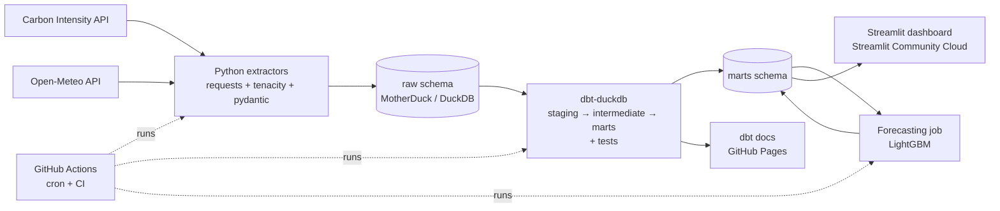

# Project 4: GB Grid Carbon Tracker. A complete plan

> An automated pipeline that collects Great Britain electricity carbon-intensity, generation-mix and weather data every few hours. It cleans the data with dbt, forecasts the next 48 hours, and serves a live public dashboard. It costs £0 to run.

---

## 0. Why this project, and the story you'll tell

**The business question (say this in interviews):**
> "When is the cleanest time to use electricity in Great Britain, what drives it, and can we predict it?"

This matters to real stakeholders:
- energy suppliers running "green tariffs"
- EV-charging companies doing smart charging
- facilities managers scheduling heavy loads
- anyone with ESG / Scope 2 reporting

**What the project proves to an employer:**
| Skill | Where it's shown |
|---|---|
| Python and APIs | Extraction layer with retries, validation, incremental loads |
| SQL and data modelling | dbt staging, intermediate and mart layers, star schema |
| Data quality | dbt tests, source freshness, pydantic validation, pytest |
| Automation and DevOps | GitHub Actions on a schedule, CI on pull requests, secrets |
| Statistics and analysis | Trend, seasonality and driver analysis, forecast-error analysis |
| Machine learning | 48h forecast, backtesting, comparison with the official forecast |
| Visualisation and communication | Live Streamlit dashboard, README findings, dbt docs site |

**Project / repo name:** `gb-grid-carbon`

---

## 1. Data sources (all free, no API keys)

### 1a. Carbon Intensity API (National Energy System Operator, NESO). `https://api.carbonintensity.org.uk`
| Endpoint | What it gives | Grain |
|---|---|---|
| `/intensity/{from}/{to}` | National forecast and actual gCO₂/kWh, plus index (very low → very high) | 30 min |
| `/generation/{from}/{to}` | National generation mix: % by fuel (gas, wind, nuclear, solar, biomass, imports, coal, hydro, other) | 30 min |
| `/regional/intensity/{from}/{to}` | 14 DNO regions + England/Scotland/Wales: forecast intensity and mix | 30 min |
| `/intensity/{from}/fw48h` | The official 48h forward forecast (your benchmark) | 30 min |

Example shape (synthetic values):
```json
{"data":[{"from":"2024-01-01T00:00Z","to":"2024-01-01T00:30Z",
  "intensity":{"forecast":120,"actual":115,"index":"moderate"}}]}
```
```json
{"data":[{"from":"2024-01-01T00:00Z","to":"2024-01-01T00:30Z",
  "generationmix":[{"fuel":"gas","perc":30.1},{"fuel":"wind","perc":41.5}]}]}
```
Verified in Phase 2 (2026-10-12; full detail in `docs/data_dictionary.md` and `docs/dev_log.md`):
- All times are **UTC** and periods are half-hours.
- **Max range per request differs by endpoint:** intensity 31 days, generation 60 days, regional 14 days. A span of *exactly* 31/14 days is rejected too, so the code uses 30 / 60 / 13-day windows.
- A request also returns the half-hour that *ends* at `from`, so adjacent windows overlap by one period. Extractors filter to `[from, to)` and loads upsert by key.
- `actual` is often `null` for recent periods and gets filled in later. **This means you must re-load the last few days on every run.**
- History begins **2017-09-11 23:00 UTC** (national intensity) and **2018-05-10 23:30 UTC** (generation mix and regional).
- Regions 1–14 are DNO areas; **15–18 are aggregates** (England, Scotland, Wales, GB).
- Upstream has **gaps**: some 30-day windows return fewer than 1,440 half-hours.

### 1b. Open-Meteo weather. `https://open-meteo.com` (free, no key, non-commercial use)
- **Historical weather** (`archive-api.open-meteo.com/v1/archive`): hourly `temperature_2m`, `wind_speed_100m`, `cloud_cover`, `shortwave_radiation`.
- **Historical *forecast* API** (`historical-forecast-api.open-meteo.com`): the weather forecasts *as they were issued*. **Use these when training your forecasting model** to avoid data leakage (explained in Phase 8).
- **Forecast API** (`api.open-meteo.com/v1/forecast`): the next 48h, for live predictions.
- Pick about 6 representative points: wind-heavy (N Scotland, North Sea coast), solar-heavy (S England), and population centres (London, Birmingham, Manchester). Store their lat/lon in a dbt **seed** file.

### 1c. Reference data (one-off downloads, stored as dbt seeds)
- Region lookup: regionid → name → country.
- UK bank holidays: `https://www.gov.uk/bank-holidays.json`.
- DNO region boundaries GeoJSON (NESO data portal) for the regional map.

---

## 2. Architecture



**Technology choices and the reason for each (put these in the README):**
| Layer | Choice | Why | Fallback |
|---|---|---|---|
| Language / env | Python 3.12, `uv` | Fast, modern, reproducible lockfile | pip + venv |
| Warehouse | **MotherDuck** (hosted DuckDB, free tier) | Cloud database that both Actions and Streamlit can reach. DuckDB SQL works locally too. | DuckDB file / Parquet published as a GitHub Release asset |
| Transform | **dbt-core + dbt-duckdb** | Industry standard for analytics engineering | Plain SQL scripts |
| Orchestration | **GitHub Actions** cron | Free, simple, visible badge | Prefect / Dagster (stretch goal) |
| ML | LightGBM, scikit-learn, (Prophet for comparison) | Strong on tabular time series, fast | statsmodels SARIMA |
| Dashboard | **Streamlit** + Plotly | Live connection, Python-only, free hosting | Evidence.dev; Tableau Public from CSV snapshot |
| Quality | pytest, ruff, pre-commit, dbt tests | Professional engineering hygiene | None |

**Cost: £0.** Everything is on free tiers.

---

## 3. Repository structure

```
gb-grid-carbon/
├── .github/workflows/
│   ├── ci.yml              # on PR/push: lint, tests, dbt build on sample data
│   ├── pipeline.yml        # cron: extract → load → dbt build → predict
│   ├── retrain.yml         # weekly: retrain + backtest model
│   └── docs.yml            # publish dbt docs to GitHub Pages
├── src/gridcarbon/
│   ├── __init__.py
│   ├── config.py           # settings from env vars (pydantic-settings)
│   ├── http.py             # shared session, retries, timeouts, user-agent
│   ├── schemas.py          # pydantic models for API responses
│   ├── extract/
│   │   ├── carbon_intensity.py
│   │   └── weather.py
│   ├── load.py             # write raw rows to warehouse (idempotent)
│   ├── state.py            # high-water marks / pipeline run log
│   └── cli.py              # `gridcarbon backfill|incremental|predict`
├── dbt/
│   ├── dbt_project.yml
│   ├── profiles.yml        # reads MOTHERDUCK_TOKEN / target from env
│   ├── packages.yml        # dbt_utils
│   ├── seeds/              # regions.csv, weather_points.csv, bank_holidays.csv
│   ├── models/
│   │   ├── sources.yml
│   │   ├── staging/
│   │   ├── intermediate/
│   │   └── marts/
│   ├── macros/
│   └── tests/              # singular tests
├── forecasting/
│   ├── features.py
│   ├── backtest.py
│   ├── train.py
│   └── predict.py
├── app/
│   ├── streamlit_app.py    # overview page
│   ├── pages/              # trends, mix, regions, forecast, planner, about
│   └── db.py               # cached queries
├── notebooks/              # 01_api_exploration, 02_eda, 03_findings, 04_model_dev
├── tests/                  # unit tests + fixtures (recorded API JSON)
├── docs/                   # architecture.png, screenshots, decisions.md
├── .env.example
├── .pre-commit-config.yaml
├── pyproject.toml
├── Makefile                # make setup / extract / dbt / test / app
└── README.md
```

---

## PHASE 1: Setup (Day 1–2)

**Install:** Git, Python 3.12, `uv`, VS Code (with Python, Jupyter and dbt Power User extensions), DuckDB CLI.

**Accounts:**
- GitHub
- MotherDuck (free, then create a token)
- Streamlit Community Cloud (sign in with GitHub)

**Steps:**
1. Create a public GitHub repo with a `README.md`, a Python `.gitignore` and an MIT licence.
2. Run `uv init`, then add the dependencies:
   - **Runtime:** `requests tenacity pydantic pydantic-settings duckdb pandas pyarrow typer python-dotenv`
   - **dbt:** `dbt-core dbt-duckdb`
   - **ML:** `lightgbm scikit-learn` (`prophet` is optional)
   - **App:** `streamlit plotly`
   - **Dev:** `pytest responses ruff pre-commit jupyter`
3. Set up `pre-commit` with ruff (lint and format), end-of-file and trailing-whitespace fixes, and `check-added-large-files`.
4. Create `.env.example` containing `MOTHERDUCK_TOKEN=`, `DB_TARGET=local|motherduck` and `LOG_LEVEL=INFO`. **Never commit `.env`.**
5. Create the `Makefile` targets: `setup`, `lint`, `test`, `extract`, `dbt-build`, `app`.
6. Work in small branches and pull requests, even on your own. It produces a visible, professional commit history.

**Done when:** `make setup && make lint && make test` all run green, even though there are no real tests yet.

---

## PHASE 2: Explore the data by hand (Day 2–3)

Notebook: `notebooks/01_api_exploration.ipynb`.
1. Call each endpoint for one day, one week and one month. **Record the maximum allowed range per request.**
2. Write down in `docs/data_dictionary.md`:
   - every field, its type, units and nullability
   - the timezone (UTC)
   - the period convention: is `from` inclusive?
3. Check for quirks:
   - nulls in `actual`
   - duplicate periods
   - missing half-hours
   - generation-mix percentages that don't sum to 100
   - fuels appearing or disappearing over time
   - Daylight Saving Time (DST) days. These matter only when converting to UK local time: 46 or 50 half-hours per local day.
4. Find the **earliest date** each endpoint returns data for.
5. Test how quickly `actual` gets filled in, so you know how many days to re-load (start with 3).
6. Save small real responses as **test fixtures** in `tests/fixtures/*.json`.

**Done when:** a data dictionary exists and you can describe every quirk.

---

## PHASE 3: Extraction layer (Week 1)

### 3a. Shared HTTP client (`http.py`)
- `requests.Session` with a timeout (e.g. 30s) and a descriptive `User-Agent` (`gb-grid-carbon (github.com/<you>/gb-grid-carbon)`).
- Retry with **tenacity**: exponential backoff on 429/5xx and connection errors, maximum 5 attempts.
- Leave a small sleep between chunked calls so you don't hammer a free API.

### 3b. Validation (`schemas.py`)
Write pydantic models that mirror the API JSON:
- `IntensityPeriod(from_: datetime, to: datetime, forecast: int | None, actual: int | None, index: Literal[...])`
- `GenerationPeriod(from_, to, mix: list[FuelShare])`
- `RegionalPeriod(...)`

If validation fails, **log it and fail loudly**. Never silently drop data.

### 3c. Extractors
- `fetch_intensity(start, end)`: splits the range into chunks no larger than the maximum, calls the API, validates, and yields records.
- Do the same for generation, regional intensity, the official 48h forecast and weather (both historical and forecast).
- Return a list of dicts or a DataFrame. **Don't** transform the data here. Keep it raw: rename to snake_case and nothing else.

### 3d. Loading raw data (`load.py`)
Raw tables, all **append-friendly and idempotent**:
| Table | Key columns | Extra columns |
|---|---|---|
| `raw.intensity_national` | `period_from` | `period_to, forecast, actual, index, _ingested_at, _run_id` |
| `raw.generation_mix` | `period_from, fuel` | `perc, _ingested_at, _run_id` |
| `raw.intensity_regional` | `period_from, region_id` | `forecast, index, mix_json, _ingested_at, _run_id` |
| `raw.official_forecast_snapshots` | `issued_at, period_from` | `forecast, _ingested_at` (**append only**, so you keep every forecast issued and can score NESO later) |
| `raw.weather_observed` | `time, point_id` | weather vars |
| `raw.weather_forecast_snapshots` | `issued_at, time, point_id` | weather vars |
| `meta.pipeline_runs` | `run_id` | `started_at, finished_at, status, rows_loaded, error` |

**Idempotency pattern:** inside one transaction, `DELETE` the rows in the window `[start, end)`, then `INSERT` the new batch. Running the pipeline twice must never create duplicates.

### 3e. CLI (`cli.py`, using typer)
- `gridcarbon backfill --start 2018-01-01 --end today` fetches history in chunks. Make it resumable by logging progress to `meta`.
- `gridcarbon incremental`:
  - Sets `start = max(period_from) - 3 days` (this re-loads late-arriving actuals) and `end = now`.
  - Also snapshots the official 48h forecast and the weather forecast.
- `gridcarbon predict` runs the model (Phase 8).

### 3f. Logging
Use the standard `logging` module with structured messages: run_id, endpoint, window, rows. Write every run to `meta.pipeline_runs`.

### 3g. Tests (`tests/`)
- Unit-test chunking: date ranges split correctly, with no gaps or overlaps.
- Parse the fixtures with `responses` (mocked HTTP) and assert the record counts and types.
- Check that a retry happens on a 503.
- Check idempotency: loading the same batch twice into in-memory DuckDB gives the same row count.

**Done when:** the backfill has loaded full history locally into DuckDB, an incremental run works, and the tests pass.

---

## PHASE 4: Warehouse (Week 1, end)

1. Run everything against a **local DuckDB file** first (`DB_TARGET=local`).
2. Create a MotherDuck database `gridcarbon` with schemas `raw`, `meta`, `staging`, `marts` and `ml`.
3. Switch with one env var (`DB_TARGET=motherduck`). The connection string is `md:gridcarbon?motherduck_token=...`, read from the env and never hard-coded.
4. Run the backfill once into MotherDuck from your laptop. Actions only does incremental runs.
5. Check the free-tier storage limits. Half-hourly data since 2018 is only a few million rows, which is tiny.

---

## PHASE 5: dbt transformations and tests (Week 2)

### 5a. Setup
- Run `dbt init` inside `dbt/`. Configure `profiles.yml` with targets `dev` (local DuckDB), `prod` (MotherDuck) and `ci` (DuckDB loaded from fixtures).
- In `packages.yml`, add `dbt-labs/dbt_utils`.
- In `sources.yml`, declare the raw tables and **source freshness** (`warn_after: 6 hours`, `error_after: 24 hours` on `_ingested_at`).

### 5b. Staging models (one per source: rename, cast, deduplicate, nothing else)
- `stg_intensity_national`: cast to `timestamptz`, deduplicate on `period_from` keeping the latest `_ingested_at` (`qualify row_number() ... = 1`).
- `stg_generation_mix`: one row per period per fuel.
- `stg_intensity_regional`: unnest the regional mix.
- `stg_official_forecast`, `stg_weather_observed`, `stg_weather_forecast`.

### 5c. Intermediate models
- `int_periods_spine`: a complete half-hour time spine from the first date to now, generated with `generate_series`. Joining to it **shows any gaps**.
- `int_generation_mix_wide`: pivots the mix into columns (`wind_pct`, `gas_pct`, …) plus derived groups: `renewable_pct` (wind+solar+hydro), `low_carbon_pct` (renewables + nuclear), `fossil_pct`.
- `int_weather_gb`: weather averaged across the chosen points and resampled from hourly to half-hourly (forward-fill or interpolate). Document which method you chose.
- `int_calendar`: UK local time (`Europe/London`), date, hour, half-hour slot, weekday, weekend, bank holiday, month, season, and a DST flag.

### 5d. Marts (star schema)
| Model | Grain | Purpose |
|---|---|---|
| `dim_date` | day | calendar attributes |
| `dim_region` | region | names, country, geometry key |
| `fct_grid_halfhourly` | half-hour | intensity (forecast/actual), mix (wide), weather, calendar. **The main analysis table.** |
| `fct_regional_halfhourly` | half-hour × region | regional intensity and mix |
| `agg_daily` | day | mean, min and max intensity, greenest half-hour, renewable share |
| `agg_hour_of_day_by_month` | month × half-hour slot | heatmap source: "greenest time of day" by season |
| `fct_official_forecast_accuracy` | issued_at × lead time | NESO forecast error by horizon (MAE by lead hours) |
| `ml.fct_model_forecasts` | written by the model | your forecasts (Phase 8) |
| `fct_model_vs_official` | period × lead | your error compared with NESO's error, period by period |

Make the large facts **incremental models** (`materialized='incremental'`, `unique_key='period_from'`, with a look-back of 3 days on each run).

### 5e. Tests (this is a big talking point in interviews)
- **Generic tests:**
  - `unique` + `not_null` on keys
  - `accepted_values` on `index` ('very low','low','moderate','high','very high') and on fuel
  - `relationships` from regional facts to `dim_region`
- **dbt_utils tests:**
  - `expression_is_true`: `perc between 0 and 100` and `intensity_actual between 0 and 1000`
  - `unique_combination_of_columns` on (period_from, region_id)
  - `recency`: the latest period is within 12 hours
- **Singular tests (custom SQL):**
  - the mix sums to 100 ± 1.5
  - no gaps in the time spine over the last 7 days (warning severity)
- **Severity:** use `error` for integrity problems and `warn` for upstream data gaps you can't control.

### 5f. Documentation
- Add a `description` to every model and column in the YAML files.
- Run `dbt docs generate`, and publish it to **GitHub Pages** with `docs.yml`. That gives you a lineage graph to show in interviews.

**Done when:** `dbt build` (run + test) passes on prod, and the docs site is live.

---

## PHASE 6: Orchestration with GitHub Actions (Week 2, end)

### 6a. `pipeline.yml`
```yaml
name: pipeline
on:
  schedule: [{cron: "17 */3 * * *"}]   # every 3h at :17 (avoid the busy :00 slot)
  workflow_dispatch: {}                 # manual run button
concurrency: {group: pipeline, cancel-in-progress: false}
jobs:
  run:
    runs-on: ubuntu-latest
    timeout-minutes: 30
    env:
      MOTHERDUCK_TOKEN: ${{ secrets.MOTHERDUCK_TOKEN }}
      DB_TARGET: motherduck
    steps:
      - uses: actions/checkout@v4
      - uses: astral-sh/setup-uv@v5
      - run: uv sync --frozen
      - run: uv run gridcarbon incremental
      - run: uv run dbt deps && uv run dbt source freshness && uv run dbt build --target prod
        working-directory: dbt
      - run: uv run gridcarbon predict
```

### 6b. `ci.yml` (on pull requests and pushes to main)
- Run `ruff check` and `ruff format --check`, then `pytest`.
- Run `dbt build --target ci` against a DuckDB file seeded from the fixtures. **CI never touches prod.**

### 6c. `retrain.yml`
Runs weekly (Sunday). It runs backtest + train, saves the model artifact as a GitHub Release asset (or in an `ml.models` table), and logs metrics to `ml.model_runs`.

### 6d. Operational gotchas to handle (and mention in your README)
- **Scheduled workflows in public repos are disabled after 60 days without repository activity.** Keep committing, or add a small keep-alive step, and note it.
- Cron start times on GitHub are **not exact**. Delays of 5–30 minutes are normal, and your design tolerates them because of the look-back window.
- Store the token in **repo Secrets**. Never print it.
- GitHub emails you when a scheduled run fails. Also add a `status` row in `meta.pipeline_runs` and show "last successful refresh" in the dashboard.
- Add status badges for the pipeline and CI to the README.

**Done when:** the pipeline has run unattended and green for 3 days or more.

---

## PHASE 7: Analysis and findings (Week 3)

Notebook `notebooks/02_eda.ipynb` explores the data. `03_findings.ipynb` is polished, with a written conclusion under every chart.

Answer these questions, each with one chart and one sentence containing a number:
1. **Long-term trend:** how much has average GB carbon intensity fallen since 2018? Show annual means and the % change. Gas and coal decline vs wind growth.
2. **Time of day:** what's the greenest half-hour on average, by season? Use the heatmap of month × time of day. How much cleaner is 3am than 6pm?
3. **Weekday vs weekend** and bank-holiday effects.
4. **Drivers:** the relationship between intensity and `wind_pct` and wind speed.
   - Do a scatter plot and a simple linear regression of intensity on wind speed, temperature and hour.
   - Report the coefficient and R².
   - Explain correlation vs causation.
5. **Regional gap:** Scotland vs South Wales or the Midlands. Box plots by region, and how often Scotland is in "very low".
6. **Official forecast accuracy:**
   - How good is NESO's own forecast? Show MAE by lead time (it should grow with horizon).
   - Is there bias (consistent over- or under-prediction)?
   - Is there a seasonal pattern in the error?
7. **Impact scenario:** "If a household EV (7 kWh/night) charges in the greenest 3 hours instead of starting at 6pm, it saves X kg CO₂ per year. Across 1M EVs, that's Y tonnes." State all assumptions.
8. **Data quality summary:** % missing actuals, gaps found, and how you handled them.

Write the **top 3–5 findings** into the README as bullets with numbers.

---

## PHASE 8: Forecasting (Week 3–4)

### 8a. Problem definition
- **Target:** national `intensity_actual` per half-hour.
- **Horizon:** the next 48h (96 steps), issued every pipeline run.
- **Benchmarks to beat or compare against:**
  1. Seasonal naïve: the value at the same time 7 days ago.
  2. Daily naïve: the value at the same time 1 day ago.
  3. **NESO's official forecast.** Honest framing: beating it is hard. Matching it, or beating it at some horizons, is a strong result. Either way, the analysis is the point.

### 8b. Avoiding leakage (explain this explicitly, because interviewers love it)
- **Lags:** for a forecast at lead *h*, you can only use actuals from before the issue time. Use either:
  - **Direct strategy:** one model with `lead_time` as a feature, using only lags available at issue time (e.g. the last known value, same slot yesterday, same slot last week), or
  - **Recursive strategy** (simpler, but errors compound). Recommendation: **direct**.
- **Weather:** train on **historical *forecasts*** from Open-Meteo's historical-forecast API, not on observed weather. At prediction time you only have forecasts. Training on observed weather would make backtests look too good.
- Fit any scaling or encoding inside each training fold only.

### 8c. Features (`features.py`)
- **Calendar:** half-hour slot, weekday, weekend, bank holiday, month, plus sin/cos encodings of time of day and day of year.
- **Lead time:** hours ahead.
- **Lags available at issue time:** last actual, rolling mean of the last 24h, same slot yesterday, same slot 7 days ago.
- **Weather forecasts:** wind speed at 100m (wind points), solar radiation (south points), temperature (population points).
- Optional: last known `wind_pct` and `gas_pct`.

### 8d. Models
1. Baselines (above).
2. Linear regression or Ridge on the same features. It's interpretable.
3. **LightGBM**, the main model. Tune lightly with a small grid or Optuna, using backtest folds only.
4. Optional: Prophet with weather regressors, for comparison.

### 8e. Backtesting (`backtest.py`)
- **Rolling-origin evaluation:** e.g. 12 folds, each training on all data before a cut-off and testing on the next 2 weeks of issued 48h forecasts.
- Report **MAE, RMSE and MAPE**, both overall and **by lead time**, alongside NESO and the baselines.
- Plots:
  - error vs lead time (yours, NESO, naïve)
  - predicted vs actual for one sample week
  - **feature importance** (LightGBM gain plus SHAP summary)
- Save the results to `docs/backtest_results.md` and to `ml.model_runs`.

### 8f. Production
- `train.py` (weekly) fits on all history and saves the model with a version tag.
- `predict.py` (every pipeline run):
  - builds features as of now, predicts 96 steps, and writes to `ml.fct_model_forecasts` (`issued_at, period_from, lead_h, yhat, model_version`)
  - optionally adds prediction intervals (LightGBM quantile objectives at 0.1 and 0.9)
- Live accuracy: once actuals arrive, `fct_model_vs_official` scores your real forecasts against NESO's. This is a genuine out-of-sample track record that grows every day, and **it is the most impressive thing in the project.**

---

## PHASE 9: Dashboard (Week 4)

**Streamlit app on Streamlit Community Cloud.** Put `MOTHERDUCK_TOKEN` in the app's Secrets, using a **read-only** token or share if MotherDuck supports it.

**Pages:**
1. **Now (home):**
   - current intensity and index as a big number with a colour band
   - the next 48h forecast (yours and NESO's)
   - **"Greenest 3-hour window in the next 48h"** callout
   - "Last refreshed" timestamp
2. **Trends:** daily/monthly intensity since 2018 with rolling averages and a year selector.
3. **Generation mix:** stacked area chart of fuel % over a selectable period, plus the renewable share trend.
4. **When is it greenest?:** month × time-of-day heatmap, and weekday vs weekend.
5. **Regions:** choropleth map of current or average intensity by DNO region, with region comparison.
6. **Forecast accuracy:** your model vs NESO vs naïve, MAE by lead time (backtest and live track record).
7. **Usage planner:** the user picks an appliance or duration (e.g. EV 4h, washing machine 2h) and gets the cleanest start time in the next 48h, plus the CO₂ saved vs starting now.
8. **About / methodology:** architecture diagram, data sources and licences, limitations, and links to the repo and dbt docs.

**Build quality:**
- Wrap queries in `@st.cache_data(ttl=1800)`.
- Query **marts only**, never raw tables.
- Use one consistent colour scale for the intensity index and label units (gCO₂/kWh).
- Check that it works on a phone-width screen.
- Note: Streamlit free apps go to sleep when idle. The first load may take about 30s, so say so in the README.

**Optional:** a Tableau Public version. Have the pipeline export `agg_daily` and the heatmap source to CSV, and build one polished "story" dashboard. It's useful if the jobs you apply for name Tableau.

---

## PHASE 10: Quality, docs and polish (Week 4, end)

### README structure
1. Title, one-line pitch, badges (pipeline, CI, licence) and a **live dashboard link**.
2. Hero screenshot or GIF.
3. Business question and who it serves.
4. **Key findings:** 3–5 bullets with numbers.
5. Architecture diagram (Mermaid) and tech stack table.
6. Data sources and licences. Credit NESO Carbon Intensity API and Open-Meteo (CC BY 4.0).
7. Data model: a short description plus a link to the dbt docs lineage graph.
8. Data quality: what is tested and how failures are surfaced.
9. Forecasting: approach, leakage handling, results table vs baselines and NESO.
10. Engineering decisions and trade-offs (`docs/decisions.md`). For example: why MotherDuck, why direct multi-step forecasting, why a 3-day look-back.
11. Limitations, e.g.:
    - weather point selection is simplistic
    - regional data is forecast-only
    - free-tier constraints
12. Future work.
13. How to run locally: `git clone` → `make setup` → `make extract` → `make dbt-build` → `make app`.

### Final checks
- [ ] A stranger can run it locally from the README in under 15 minutes.
- [ ] There are no secrets in the git history. Run a secret scanner (`gitleaks`) once.
- [ ] Notebooks are cleared of huge outputs, numbered, and have narrative markdown.
- [ ] Every chart has a title, units and a takeaway sentence.
- [ ] The repo is pinned on GitHub, with topic tags (data-engineering, dbt, duckdb, streamlit, forecasting).

---

## PHASE 11: Showcase it

**CV bullets (choose 2–3 and put in your real numbers):**
- *"Built an automated ELT pipeline (Python, GitHub Actions, dbt, DuckDB/MotherDuck) ingesting 2M+ half-hourly GB grid carbon and weather records every 3 hours, with 40+ dbt data-quality tests and source-freshness monitoring."*
- *"Developed a LightGBM 48-hour carbon-intensity forecast with leakage-safe rolling backtests; achieved MAE of X gCO₂/kWh vs Y for the official NESO forecast at 24h lead time."*
- *"Deployed a live Streamlit dashboard with a usage planner that finds the lowest-carbon time window, showing that shifting EV charging could cut emissions by Z%."*

**Other places to show it:**
- **LinkedIn post:** 3 findings, a screenshot, and the live link.
- **2-minute Loom video** walking through the dashboard and the architecture. Link it in the README.

**Interview prep (be able to answer):**
- Why dbt? What's the difference between staging and marts?
- How do you make a pipeline idempotent? How do you handle late-arriving data?
- What happens if the API is down for a day?
- How did you avoid leakage in your forecast? Why not use observed weather?
- Why does error grow with lead time? Why compare against NESO?
- What would you change at 100× the data or for a real company? (Airflow/Dagster, a cloud warehouse, alerting, CI/CD environments.)
- What was the hardest bug? (Keep a `docs/dev_log.md` as you go so you have real stories.)

---

## Timeline (about 10–12 hrs/week; ~5 weeks total)
| Week | Deliverable |
|---|---|
| 1 | Setup, API exploration, extractors, raw load, backfill, tests |
| 2 | dbt models + tests + docs site, GitHub Actions pipeline + CI running |
| 3 | EDA and findings notebook, forecast feature engineering, baselines, backtesting |
| 4 | Final model in production, Streamlit dashboard deployed |
| 5 | README, screenshots, video, CV bullets, LinkedIn post, buffer for bugs |

**Ship something early:** by the end of week 2 you should have a working pipeline and a basic one-chart Streamlit page live. Improve from there rather than doing a big reveal at the end.

---

## Risks and mitigations
| Risk | Mitigation |
|---|---|
| API outage or schema change | Retries; pydantic validation fails loudly; the look-back window catches up after outages; source-freshness alerts |
| Late or revised actuals | 3-day re-load window plus incremental models with a look-back |
| Duplicates | Delete-insert per window, `qualify row_number()` deduplication in staging, `unique` tests |
| Timezone / DST bugs | Store everything in UTC; convert to Europe/London only in `int_calendar`; test DST days explicitly |
| Leakage in the model | Direct strategy, issue-time features only, historical weather forecasts, rolling-origin backtest |
| Actions cron disabled or late | Keep-alive or regular commits; tolerant design; manual `workflow_dispatch` |
| Free tier limits (MotherDuck/Streamlit) | Data is small; fallback to a DuckDB file published as a Release asset |
| Scope creep | Ship the MVP (pipeline + 3 dashboard pages) before the ML and extras |

---

## Stretch goals (only after everything above is done)
- Swap Actions for **Dagster** or **Prefect** (asset graph, better observability).
- Add **NESO demand data** (national demand, embedded wind/solar) as forecast features.
- Use **Great Expectations** or Soda for data contracts.
- Run the pipeline inside a Docker container.
- Add a carbon-aware scheduling API endpoint with FastAPI.
- Track drift: alert if live MAE degrades by more than 20% vs the backtest.
- Do a probabilistic forecast evaluation (pinball loss, interval coverage).

---

## Definition of done
- [ ] The pipeline has run unattended for 7+ days with green badges.
- [ ] Full history is backfilled; `dbt build` passes all tests; the docs site is live.
- [ ] The findings notebook has 5+ quantified insights, summarised in the README.
- [ ] The forecast is backtested against naïve and NESO, and live predictions are being scored.
- [ ] The dashboard is live with at least the Now, Trends, Greenest-time, Forecast and Planner pages.
- [ ] The README, architecture diagram, screenshots and video are complete. CV bullets are written with real numbers.
